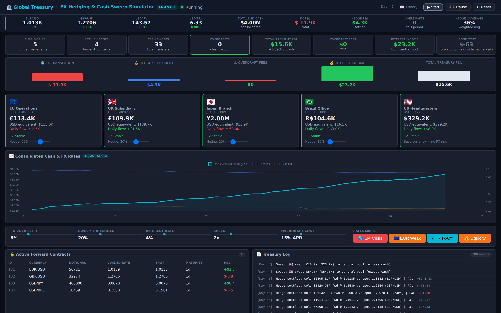
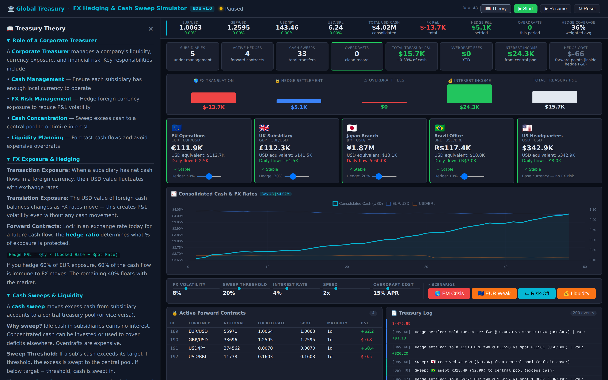
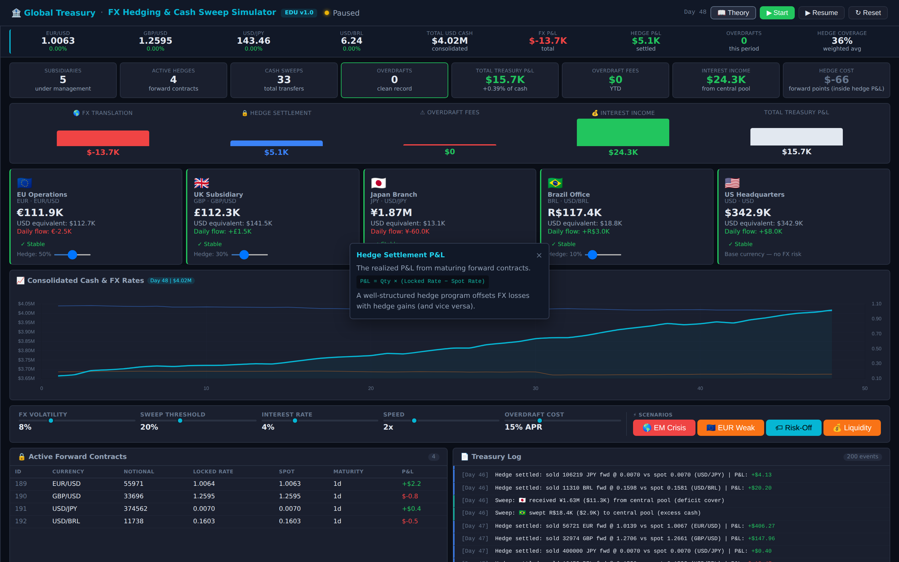
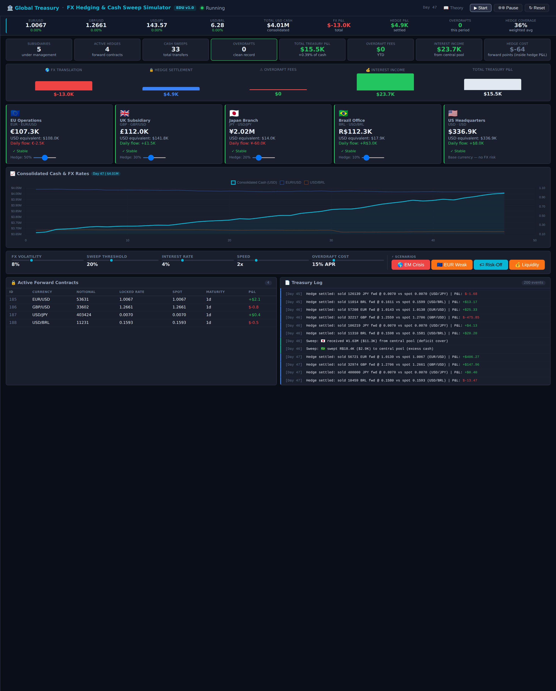

<div align="center">

# Global Treasury Manager

**An FX-hedging and cash-sweep simulator for corporate treasury, in one HTML file.**

Run the treasury of a multinational with five subsidiaries and four foreign currencies. Set hedge ratios, sweep cash into a USD pool, survive currency shocks, and watch the P&L break down into translation, hedging, interest and overdraft costs.

[](index.html)
[](https://www.chartjs.org/)
[](LICENSE)
[](https://github.com/mutima89/treasury-manager-sim/commits)

[Overview](#overview) · [Screenshots](#screenshots) · [Quick start](#quick-start) · [The model](#the-model) · [Scenarios](#scenarios) · [Learning path](#suggested-learning-path)



</div>

---

## Overview

| | |
|---|---|
| **Subsidiaries** | US headquarters plus EU, UK, Japan and Brazil operations, each holding cash in its own currency with its own daily cash flows |
| **FX rates** | EUR, GBP, JPY and BRL follow geometric Brownian motion at their own volatilities (6–14%), scaled by a global volatility control |
| **Hedging** | Per-currency hedge ratios (0–100%) roll one-day forwards on each foreign cash balance, priced from interest-rate differentials |
| **Cash concentration** | Excess cash above a target band is swept into a USD central pool at spot; shortfalls are funded back from it |
| **Costs and income** | Interest accrues on the pool; negative subsidiary balances pay overdraft interest at a configurable rate |
| **P&L attribution** | A waterfall splits total P&L into FX translation, hedge settlement, interest income and overdraft fees |
| **Teaching layer** | Theory panel, click-to-explain metrics, and a plain-English activity log for every sweep, settlement and overdraft |

No build step, no backend, no account. Everything runs in the browser.

## Screenshots

| Theory panel | Concept help |
|:---:|:---:|
|  |  |

<details>
<summary>Full page</summary>



</details>

## Quick start

1. Download or clone the repository.
2. Open `index.html` in a modern browser (Chrome, Edge, Firefox or Safari).
3. Press **Start**.

The page loads Chart.js from a CDN, so it needs an internet connection the first time.

### Controls

| Control | Range | Effect |
|---|---|---|
| FX volatility | 2–25% | Scales every currency's volatility (8% = the base settings) |
| Sweep threshold | 5–50% | Band around each subsidiary's target cash before a sweep triggers |
| Interest rate | 1–12% | Annual USD rate earned by the central pool, also used in forward pricing |
| Overdraft cost | 5–40% APR | Penalty rate on negative subsidiary balances |
| Speed | 1×–5× | One simulated day every 600 ms at 1×, 120 ms at 5× |
| Hedge ratio (per currency) | 0–100% | Share of that subsidiary's balance hedged with forwards |

## The model

Each simulated day runs in a fixed order:

1. **Rates move.** Each foreign rate (stored as USD per unit of local currency) takes a GBM step.
2. **Translation P&L** is booked on the balances held while rates moved: `cash × (new rate − old rate)`. Shocks applied between days are captured too.
3. **Forwards settle.** Each matured forward pays `quantity × (locked rate − spot)` in USD into the central pool.
4. **Operating cash flows** arrive in local currency.
5. **Sweeps** move cash between subsidiaries and the USD pool, converted at spot.
6. **Overdraft fees** accrue in local currency and are booked in USD.
7. **Interest** accrues on the pool.
8. **New one-day forwards** sell the hedged share of each foreign balance at `spot × e^((r_USD − r_local) × T)`, using approximate local rates of EUR 3%, GBP 4.5%, JPY 0.5% and BRL 11%.

```text
Total Treasury P&L = FX Translation + Hedge Settlement + Interest Income − Overdraft Fees
```

Because every flow passes through cash, the books close exactly: the change in total USD cash equals operating cash flows plus total P&L. Forward points are already inside hedge settlement; the **Hedge Cost** card shows them separately for information.

In a 250-day test with a fixed seed, raising all hedge ratios from 0% to 100% cut the standard deviation of daily FX-plus-hedge P&L from about $800 to about $60.

### Subsidiaries

| Subsidiary | Currency | Opening cash | Mean daily flow | Volatility |
|---|---|---|---|---|
| US Headquarters | USD | $2,000,000 | +$8,000 | — |
| EU Operations | EUR | €800,000 | −€2,500 | 7% |
| UK Subsidiary | GBP | £500,000 | +£1,500 | 6% |
| Japan Branch | JPY | ¥10,000,000 | −¥60,000 | 8% |
| Brazil Office | BRL | R$500,000 | +R$3,000 | 14% |

## Scenarios

| Button | Shock | What it teaches |
|---|---|---|
| EM Crisis | BRL −20% | Emerging-market currency risk |
| EUR Weak | EUR −8% | Concentration in the largest foreign balance |
| Risk-Off | BRL −15%, EUR −3%, GBP −2% | Correlated moves in a crisis |
| Liquidity | Each subsidiary loses 30–50% of its target cash | Funding shortfalls and overdraft cost |

## Suggested learning path

1. Run 20–30 days with every hedge at 50% and read the P&L waterfall.
2. Set every hedge to 0% and trigger **EM Crisis**; watch translation losses in Brazil.
3. Set EUR to 100% and the rest to 0%, then trigger **EUR Weak**: the hedge offsets the EUR translation loss.
4. Compare sweep thresholds of 5% and 50% and how often overdrafts appear.
5. Trigger **Liquidity** and see how the pool funds the shortfalls.

## Project structure

```text
treasury-manager-sim/
├── index.html                         The complete simulator
├── scripts/capture_screenshots.py     Rebuilds the README screenshots (headless Chromium)
├── .github/workflows/screenshots.yml  Runs that script on GitHub Actions
├── docs/screenshots/
└── LICENSE
```

## License

MIT — see [LICENSE](LICENSE). Educational tool; all market data is synthetic and nothing here is financial advice.
